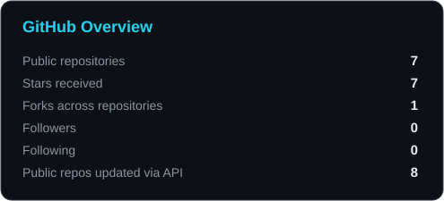
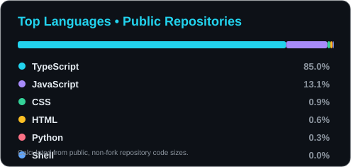

<div align="center">


<br/>


</div>

---

## `whoami` — About Me

```python
class Developer:
    def __init__(self):
        self.name = "Guru Mallesh"
        self.role = "CSE Engineering Student"
        self.interests = [
            "Software Development",
            "Web Technologies",
            "Artificial Intelligence",
            "Creative Problem Solving"
        ]
        self.current_focus = "Learning by Building"

    def motto(self):
        return "Dream. Build. Debug. Repeat."


me = Developer()
print(me.motto())
```

## `tech_stack` — Technologies I'm Exploring

<div align="center">

### Languages


### Web Development


### Tools & Platforms


</div>

---

## `github_stats` — My GitHub Overview

<div align="center">




</div>

---

## `contributions` — Consistency Over Perfection

<div align="center">


</div>

---

## `featured_projects` — Things I'm Building

<div align="center">

<a href="https://github.com/gurumalleshh?tab=repositories">
  
</a>

</div>

Explore my repositories to discover my projects, experiments, and learning journey.

---

## `connect` — Let's Connect

<div align="center">

<a href="https://github.com/gurumalleshh">
  
</a>

<a href="https://www.linkedin.com/in/guru-mallesh-17b51738a">
  
</a>

<br/><br/>

**Building my skills today. Building better things tomorrow.**


</div>
